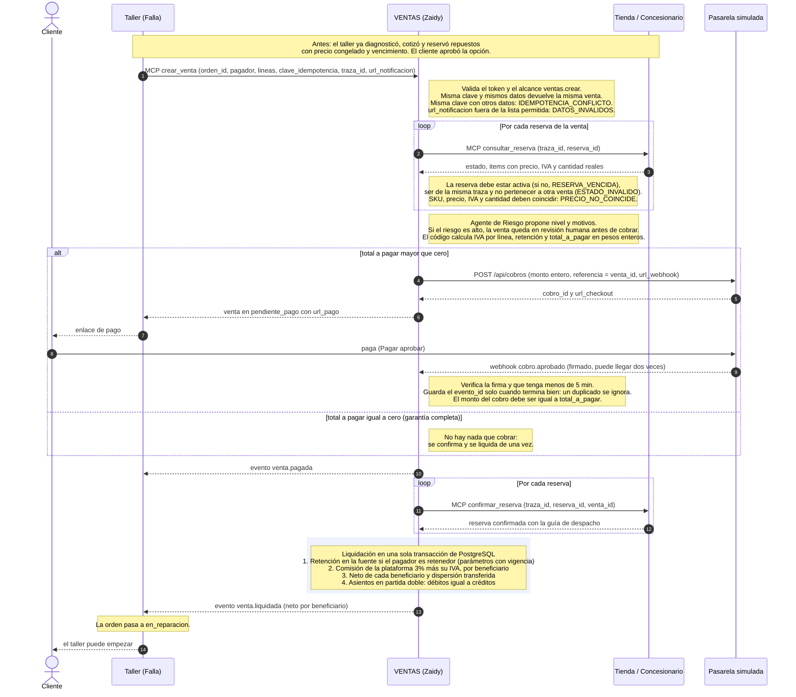
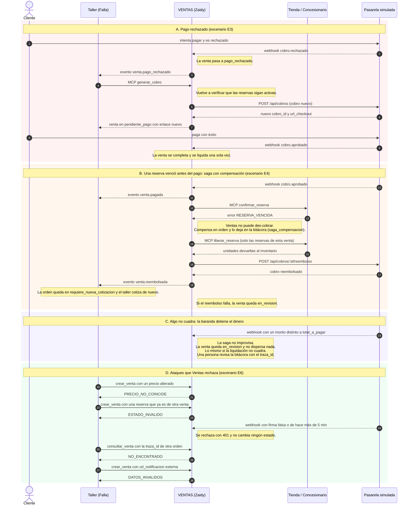

# Diagrama de secuencia: Ventas y contabilidad frente a los demás servicios

Servicio del grupo de Zaidy dentro de MotorRed (Instructivo N.° 5). Ventas es el **orquestador comercial**: arma la venta, cobra, confirma a los proveedores, liquida, dispersa el dinero y lleva los asientos. Es el único que mueve dinero.

Contrastado con el kit `ecosistema-motor` (contrato 1.0): `contrato/REGLAS.md`, `docs/contrato.md`, `simuladores/ventas.mjs` y `simuladores/pasarela.mjs`. Los nombres de herramientas, alcances, estados, eventos y códigos de error son los del kit.

## Quién habla con quién

| Origen | Destino | Cómo | Alcance / protección |
|---|---|---|---|
| Taller | Ventas | MCP `crear_venta`, `consultar_venta`, `generar_cobro`, `anular_venta`, `consultar_liquidacion` | Cliente `taller`, alcance `ventas.crear` |
| App del cliente | Ventas | MCP `consultar_venta`, `generar_cobro`, `consultar_liquidacion` | Cliente `app`, alcance `ventas.consultar` |
| Ventas | Tienda y Concesionario | MCP `consultar_reserva`, `confirmar_reserva`, `liberar_reserva` | Cliente `ventas`, alcance `proveedor.confirmar` |
| Ventas | Pasarela | `POST /api/cobros` y `POST /api/cobros/:id/reembolso` | Llave de API (`Authorization: Bearer`) |
| Pasarela | Ventas | Webhook `POST /webhooks/pasarela` (`cobro.aprobado`, `cobro.rechazado`, `cobro.reembolsado`) | Firma `X-Pasarela-Firma`, máximo 5 min, idempotente por `evento_id` |
| Ventas | Taller | `POST /eventos`: `venta.pagada`, `venta.liquidada`, `venta.pago_rechazado`, `venta.reembolsada` | Firma `X-Firma`; solo a `NOTIFICACIONES_PERMITIDAS` |
| Auditor | Todos | `GET /bitacora?traza_id=` | Alcance `auditoria` |

Estados de una venta: `pendiente_pago`, `pago_rechazado`, `pagada`, `liquidada`, `reembolsada`, `anulada` y `en_revision`.

## 1. Camino feliz: de la venta a la liquidación

Los eventos de una misma venta salen **en orden**: `venta.pagada` siempre antes que `venta.liquidada`.

## 2. Fallos y compensaciones

## 3. Dónde entran los agentes de IA de Ventas

El simulador de referencia del kit **no trae** el agente de Riesgo ni los demás: son parte del trabajo del grupo (Trabajos 4 y 5 del instructivo).

## Imágenes

Por si tu visor no dibuja Mermaid: [camino feliz](diagramas/ventas-1-camino-feliz.png), [fallos y compensaciones](diagramas/ventas-2-fallos-y-compensaciones.png) y [agentes](diagramas/ventas-3-agentes.png).
