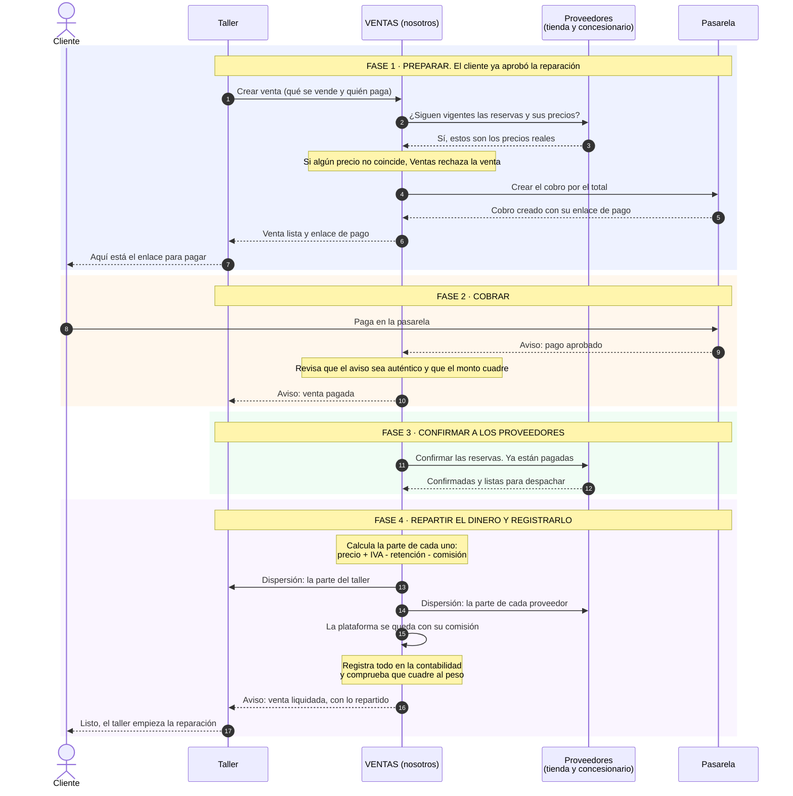
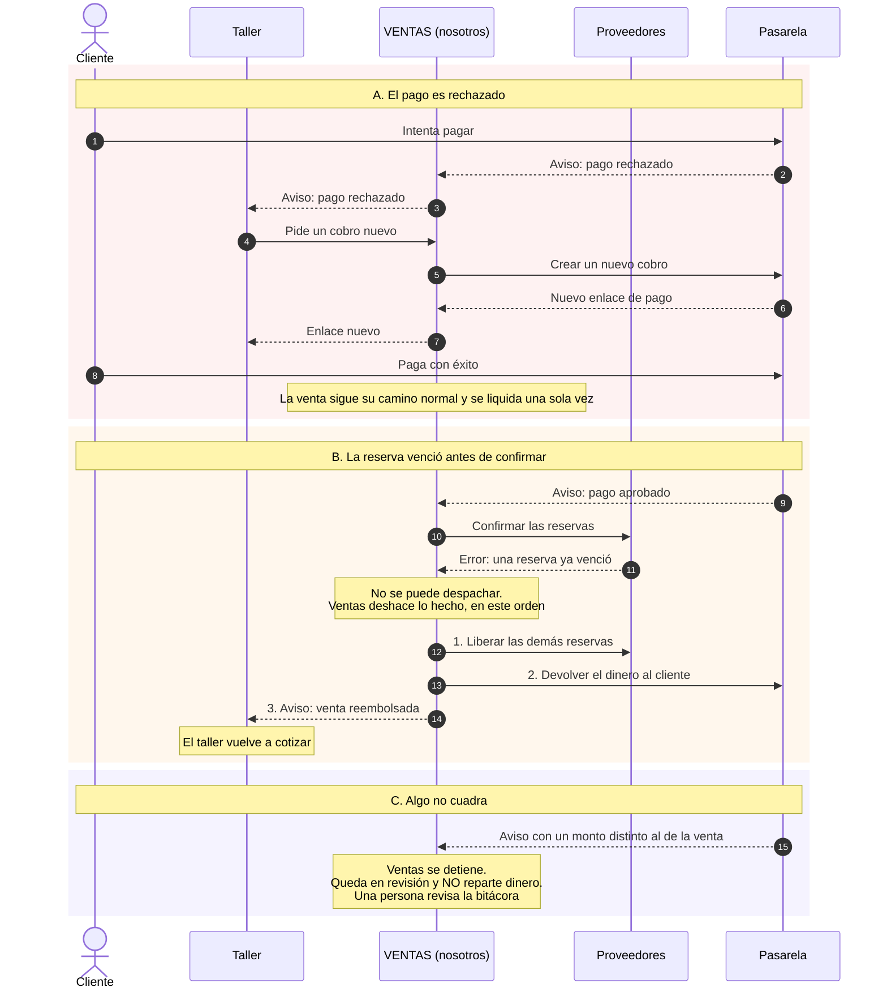
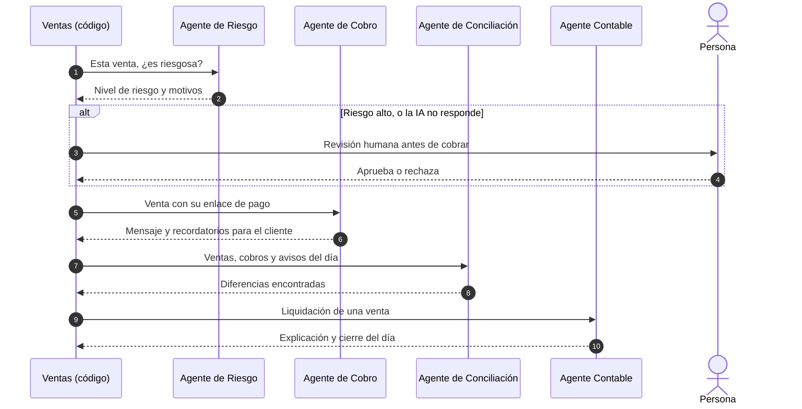

# Cómo funciona Ventas (grupo de Zaidy) frente a los demás

**En una frase:** Ventas es la **caja** del ecosistema. El taller le pide cobrar una reparación, Ventas cobra al cliente, avisa a las tiendas que despachen, **reparte el dinero** entre quienes vendieron y lleva la contabilidad.

Es el único servicio que maneja dinero. Contrastado con el kit `ecosistema-motor` (contrato 1.0).

## Quién es quién

| Actor | Qué hace en la historia |
|---|---|
| **Cliente** | Es la persona que lleva su carro y paga. |
| **Taller** (Falla) | Diagnostica, cotiza y le pide a Ventas que cobre. |
| **Ventas** (Zaidy) | **Nosotros.** Cobra, confirma, reparte y registra. |
| **Proveedores** (José y Emerson) | La tienda de repuestos y el concesionario. Tienen los repuestos reservados. |
| **Pasarela** | Donde el cliente paga. Es simulada y viene en el kit. |

## Palabras que verás

| Palabra | Qué significa |
|---|---|
| **Reserva** | Repuestos apartados para esa orden, con el precio congelado y una hora de vencimiento. |
| **Cobro** | La orden de pago que Ventas crea en la pasarela. Trae un enlace para que el cliente pague. |
| **Webhook** | El aviso automático que la pasarela le manda a Ventas cuando el cliente pagó. Va firmado, y puede llegar repetido. |
| **Liquidar** | Calcular cuánto le toca a cada uno del dinero recibido. |
| **Dispersión** | El reparto: a cada beneficiario se le registra su parte. En el kit es un registro contable, no una transferencia real. |
| **Comisión** | El 3 % que se queda la plataforma por el servicio, más el IVA de esa comisión. |
| **Compensación** | Deshacer lo hecho cuando algo falla después del pago: liberar reservas y devolver el dinero. |
| **en_revision** | Ventas se detiene y una persona revisa, porque algo no cuadró. Nunca dispersa dinero así. |

## 1. La venta completa, en cuatro fases

Línea continua: una petición. Línea punteada: una respuesta o un aviso.

### Ejemplo con números reales (orden de Ana, opción económica)

Ana pagó **$345.219**. Así se reparte:

| Beneficiario | Base | IVA | Comisión (3 %) | IVA de la comisión | **Le llega** |
|---|---|---|---|---|---|
| Tienda | $147.600 | $28.044 | $4.428 | $841 | **$170.375** |
| Taller | $142.500 | $27.075 | $4.275 | $812 | **$164.488** |
| Plataforma (Ventas) | | | | | **$10.356** |
| **Total** | | | | | **$345.219** |

Lo que reciben tienda y taller, más lo que retiene la plataforma, es **exactamente** lo que pagó Ana. Si no cuadra, la venta queda en revisión.

## 2. Cuando algo sale mal

### Ataques que Ventas rechaza

| Qué intentan | Qué responde Ventas |
|---|---|
| Cobrar un precio distinto al de la reserva | `PRECIO_NO_COINCIDE` |
| Usar una reserva que ya es de otra venta | `ESTADO_INVALIDO` |
| Mandar un aviso de pago con firma falsa o vieja (más de 5 min) | Lo rechaza y no cambia nada |
| Consultar una venta con la traza de otra orden | `NO_ENCONTRADO` |
| Pedir que los avisos se envíen a una dirección externa | `DATOS_INVALIDOS` |
| Repetir la misma petición | Devuelve lo mismo, sin cobrar dos veces. Con otros datos: `IDEMPOTENCIA_CONFLICTO` |

## 3. Dónde ayuda la inteligencia artificial

La IA solo propone. Quien decide siempre es el código, y ningún agente puede crear, cambiar ni anular una venta ni mover dinero.

El simulador del kit no trae estos agentes: los construye el grupo.

## Referencia técnica (para programar)

| Origen | Destino | Cómo | Protección |
|---|---|---|---|
| Taller | Ventas | `crear_venta`, `consultar_venta`, `generar_cobro`, `anular_venta`, `consultar_liquidacion` | Token OAuth, alcance `ventas.crear` |
| Ventas | Proveedores | `consultar_reserva`, `confirmar_reserva`, `liberar_reserva` | Alcance `proveedor.confirmar` |
| Ventas | Pasarela | `POST /api/cobros` y `POST /api/cobros/:id/reembolso` | Llave de API |
| Pasarela | Ventas | `POST /webhooks/pasarela` | Firma `X-Pasarela-Firma`, máximo 5 min, `evento_id` único |
| Ventas | Taller | `POST /eventos`: `venta.pagada`, `venta.liquidada`, `venta.pago_rechazado`, `venta.reembolsada` | Firma `X-Firma`, solo destinos permitidos |

Estados de una venta: `pendiente_pago`, `pago_rechazado`, `pagada`, `liquidada`, `reembolsada`, `anulada` y `en_revision`. Los eventos de una misma venta salen en orden: `venta.pagada` antes que `venta.liquidada`.

## Imágenes

Por si tu visor no dibuja Mermaid: [venta completa](diagramas/ventas-1-camino-feliz.png), [cuando algo sale mal](diagramas/ventas-2-fallos-y-compensaciones.png) y [agentes](diagramas/ventas-3-agentes.png).
