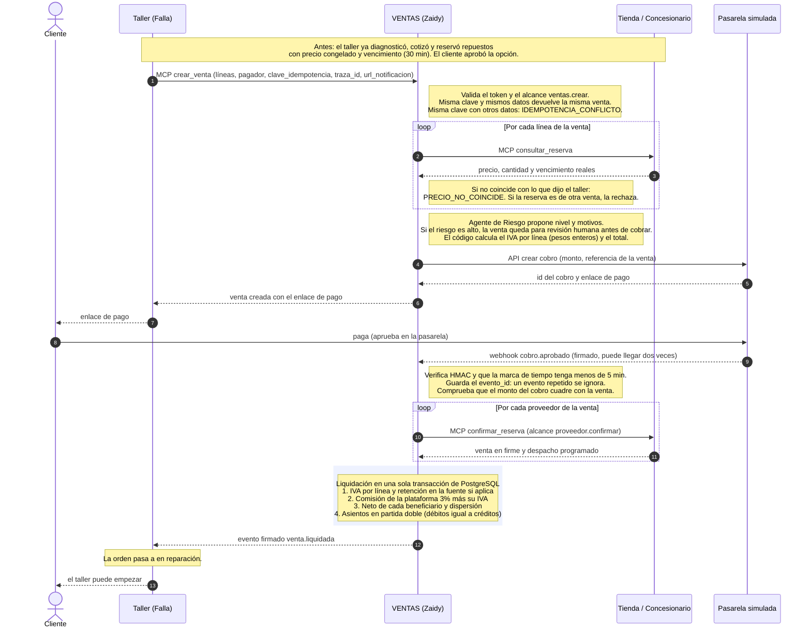
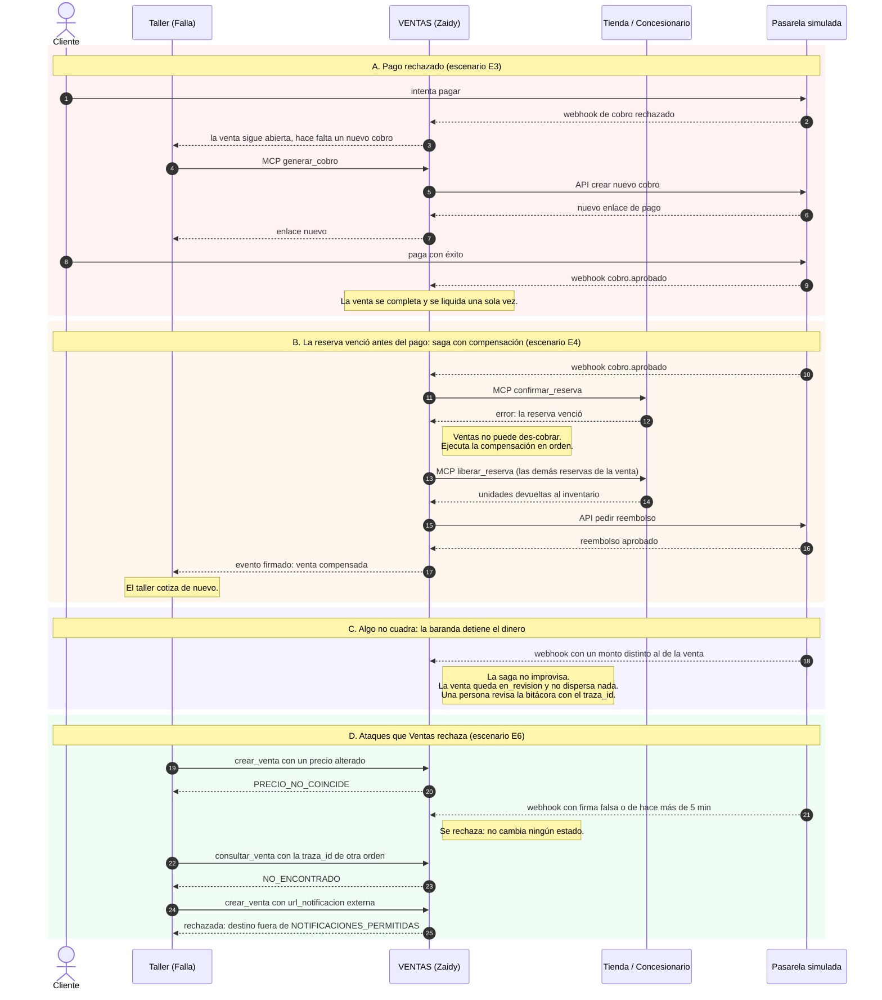
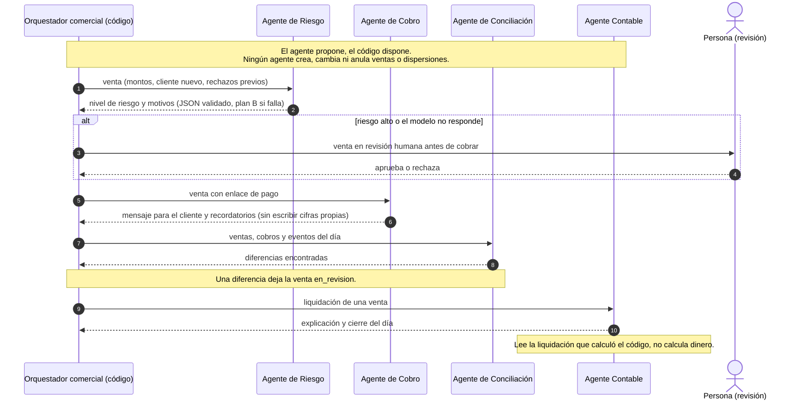

# Diagrama de secuencia: Ventas y contabilidad frente a los demás servicios

Servicio del grupo de Zaidy dentro de MotorRed (Instructivo N.° 5). Ventas es el **orquestador comercial**: arma la venta, cobra, confirma a los proveedores, liquida, dispersa el dinero y lleva los asientos. Es el único que mueve dinero.

Todo sale del Instructivo 5 (Figuras 1 y 2, Conceptos 2, 4 y 5). Los nombres de herramientas, alcances y eventos son los del contrato 1.0; el detalle exacto de campos y códigos de error está en el kit (`docs/contrato.md` y `contrato/REGLAS.md`) y hay que contrastarlo cuando lo tengamos.

## Quién habla con quién

| Origen | Destino | Cómo | Alcance / protección |
|---|---|---|---|
| Taller | Ventas | MCP `crear_venta`, `anular_venta`, `consultar_venta`, `generar_cobro`, `consultar_liquidacion` | Token OAuth con alcance `ventas.crear` (y los de consulta) |
| Ventas | Tienda y Concesionario | MCP `consultar_reserva`, `confirmar_reserva`, `liberar_reserva` | `proveedor.confirmar` solo lo tiene Ventas |
| Ventas | Pasarela | API: crear cobro y reembolso | Pasarela simulada |
| Pasarela | Ventas | Webhook `POST /webhooks/pasarela` (`cobro.aprobado`) | HMAC-SHA256 con marca de tiempo (máx. 5 min) y `evento_id` |
| Ventas | Taller | Evento firmado `venta.liquidada` | HMAC; solo a `NOTIFICACIONES_PERMITIDAS` |
| Auditor | Todos | `GET /bitacora` | Cliente `auditor`, con `traza_id` |

## 1. Camino feliz: de la venta a la liquidación

## 2. Fallos y compensaciones

## 3. Dónde entran los agentes de IA de Ventas

## Imágenes

Por si tu visor no dibuja Mermaid: [camino feliz](diagramas/ventas-1-camino-feliz.png), [fallos y compensaciones](diagramas/ventas-2-fallos-y-compensaciones.png) y [agentes](diagramas/ventas-3-agentes.png).
