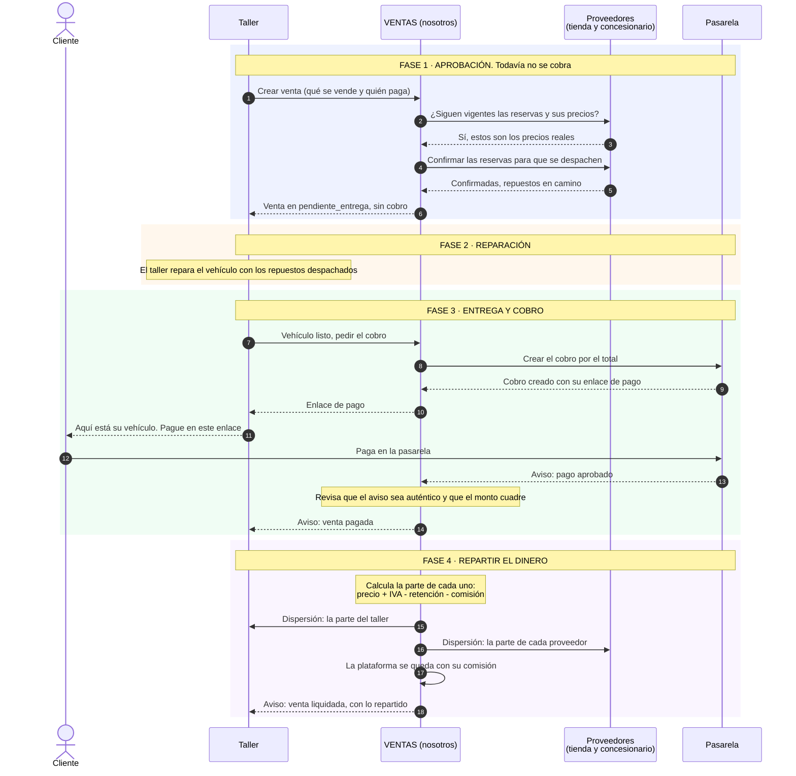

# Solicitud de cambio al contrato MotorRed: pago al entregar el vehículo

**Propone:** grupo de Ventas y contabilidad (Zaidy). **Estado:** borrador, pendiente de aprobación de los cuatro líderes técnicos. **Versión propuesta:** 1.1.

## Qué cambia

En el contrato 1.0 el cliente paga **antes** de la reparación: el pago dispara la confirmación de reservas, el despacho de repuestos y el aviso `venta.liquidada`, que le dice al taller que puede empezar.

Proponemos que el cliente pague **al recibir el vehículo ya reparado**. Es lo que ocurre en un taller real.

## Por qué

- El cliente no paga por un trabajo que todavía no ve terminado.
- El taller puede confirmar el precio final, incluso con ajustes, cuando entrega.

## Cómo funcionaría

| Momento | Hoy (1.0) | Propuesto (1.1) |
|---|---|---|
| El cliente aprueba la opción | El taller llama `crear_venta`, que **crea el cobro** | El taller llama `crear_venta`. Ventas verifica las reservas, **confirma las reservas** (para que se despachen los repuestos) y la venta queda en el estado nuevo `pendiente_entrega`. **No hay cobro.** |
| La reparación | Empieza cuando llega `venta.liquidada` | Empieza ya, sin esperar el pago |
| Se entrega el vehículo | (nada) | El taller llama `generar_cobro`. Ventas crea el cobro y devuelve el enlace de pago |
| El cliente paga | Antes de reparar | **Al recibir el vehículo** |
| Después del pago | Confirma reservas, liquida y avisa | Liquida y avisa `venta.pagada` y `venta.liquidada` (las reservas ya estaban confirmadas) |

### Diagrama

## A quién afecta

| Grupo | Qué tiene que cambiar |
|---|---|
| **Ventas** | Estado nuevo `pendiente_entrega`. `crear_venta` confirma reservas y no crea cobro. `generar_cobro` también sirve desde `pendiente_entrega`. Al aprobarse el pago, ya no confirma reservas: solo liquida. |
| **Taller** | Empieza a reparar tras `crear_venta`, no tras `venta.liquidada`. Llama `generar_cobro` al entregar. Sus estados cambian (la orden queda en reparación antes del pago, y se cierra con `venta.liquidada`). |
| **Tienda y Concesionario** | `confirmar_reserva` se llama antes del pago. Deben aceptarlo igual (hoy lo aceptan con la venta como referencia). Una reserva confirmada solo la libera Ventas, como hasta ahora. |
| **Contrato** | `ESTADOS_VENTA` gana `pendiente_entrega`. Cambian las reglas de saga, los escenarios y las pruebas de conformidad. |

## Riesgos que hay que aceptar o resolver

1. **Se despachan repuestos antes de cobrar.** Si el cliente no paga, el dinero de los repuestos ya salió del inventario. Mitigaciones posibles: un **anticipo** que cubra los repuestos, o dejar la venta en `en_revision` si pasan N días sin pago.
2. **Anular después de despachar.** `anular_venta` hoy solo sirve en `pendiente_pago` y `pago_rechazado`. Hay que decidir qué pasa con una venta `pendiente_entrega` cancelada y con los repuestos ya confirmados.
3. **Pago rechazado en la entrega.** El vehículo ya está reparado. Se mantiene `pago_rechazado` y un nuevo `generar_cobro`, y la entrega queda pendiente hasta cobrar.
4. **El total puede cambiar.** Si el taller agrega repuestos al final, ese ajuste necesita una venta aparte, porque la venta verificada contra las reservas no se modifica.

## Cómo se probaría

- **Escenario nuevo, pago al entregar:** crear la venta, confirmar que no hay cobro y que las reservas quedaron confirmadas, entregar, pagar y liquidar.
- **Escenario nuevo, pago rechazado al entregar:** nuevo cobro hasta que apruebe, y se liquida una sola vez.
- **Escenarios E1 a E6:** se ajustan al orden nuevo y se vuelven a correr con los cuatro servicios reales.
- **Conformidad:** actualizar `contrato/` y `pruebas/conformidad.mjs`; los cuatro grupos suben a la versión 1.1 el mismo día.

## Importante

Mientras no se apruebe esta solicitud, **sigue vigente el contrato 1.0** (pago antes de reparar) y es contra el que se evalúa. Ningún grupo debe implementar este cambio por su cuenta.

## Imagen

[Flujo con pago al entregar](diagramas/ventas-4-pago-al-entregar.png)
